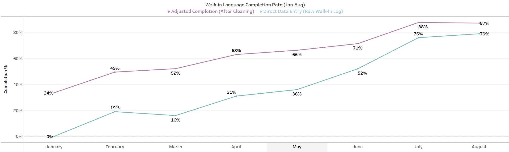
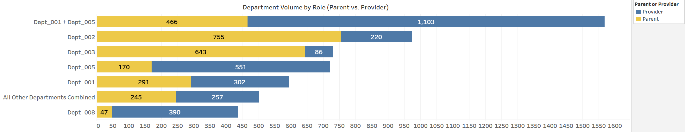

# Front Desk Data Analysis (Jan-Aug 2026)

**Tools Used:** Tableau, Google Sheets, SQL
**Dataset:** 9,785 Anonymized Check-In Records
**Live Project Links:** [Google Sheets Dashboard & Clean Dataset] https://docs.google.com/spreadsheets/d/1nH3tGNnosZllH-LPCdV2g2QsOcYYAA7ljz-FLvwEHRo/edit?gid=1638947559#gid=1638947559 | [Tableau Public Visualizations]https://public.tableau.com/views/2026_Data_Report_Front_Desk_Jan_thru_Aug/Walk-inLanguageCompletionRateJan-Aug?:language=en-US&:sid=&:redirect=auth&:display_count=n&:origin=viz_share_link
## Overview

I analyzed eight months of front desk check-in data (9,785 interactions) for a non-profit that manages child care subsidies. My goal was to answer four practical questions for executive leadership for current information and to establish accuracy for future data collection processes at the front desk: how accurate staff are logging visitor data, what prominent languages clients speak, how clients are being transferred across departments, and where clients experience poor customer service.

## Data Cleaning & Preparation

* Client names, phone numbers, staff names and departments have been anonymized and replaced with placeholders, as well as individual "notes" sections have been deleted to preserve sensitive information.

* After seeing high rates of blank fields in early logs, I purposely changed our lobby sign-in sheets and phone log surveys to capture cleaner, more complete answers.

* Early in the year, clients often skipped the language field during busy walk-in hours. I matched repeat visitors against their historical records to fill in missing language data, creating two separate metrics: **Raw Data** (Direct Data Entry by staff) and **Inferred Data** (Adjusted Completion using past records).

* I also grouped 30+ low-volume departments into an "All Other Departments Combined" bucket so the charts stay clean and focus on the core teams handling the bulk of the traffic.

## Key Findings (From the 4 Core Visuals)

1. **Walk-In Language Logging Jumped from 0% to 79%:** In January, 0% of the time a visitor walked into the organization they filled in a language, leaving us reliant on backfilled records (34% inferred). After updating the intake process and training staff, real-time logging climbed steadily to 79% in August (87% when combined with historical backfill).

2. **Over 1 in 4 Visitors Speak Spanish:** While English accounts for 68.8% of visits, Spanish (16.8%) and bilingual English/Spanish (11.7%) clients make up 28.5% of all front desk traffic, proving that department bilingual staffing is essential to helping our community.

3. **Departments Serve Highly Specialized Roles:** Of the interactions that identified a role, overall traffic splits evenly between child care Providers (50.6%) and Parents (45.3%), with 3.7% Other. However, department workloads vary heavily with client interactions: Dept_001 + Dept_005 (70.3% Provider), Dept_005 (76.4% Provider), and Dept_008 (89.2% Provider) primarily serve providers, while Dept_002 (77.4% Parent) and Dept_003 (88.2% Parent) primarily work with families.

4. **Identified 3 Departments with Declining Customer Service Scores:** Tracking monthly performance revealed significant service drops from June to August for three core teams. Dept_002 fell from 91.7% to 85.9%, Dept_005 dropped from 96.1% to 91.3%, and Dept_008 experienced the steepest decline from 97.8% down to 79.5%.

## Dashboard & Data Visualization

* I created horizontal bar charts, line graphs, pie charts, and bubble charts with upright labels so leadership can read every metric and make adjustments depending on what anyone would want to look at.

* I uploaded important graphs in Tableau to give leadership both a live day-to-day spreadsheet and a clean 3 quarter visual for the questions that were asked.

## As A Result Of This Project

* I showed leadership that our large jump in logged visits came from training the front desk team and fixing how we collect data, meaning our measured numbers now match how busy the front desk has been this whole time.

* Before this project, we only judged customer service metrics using post-service surveys, and only to people who found childcare, which gave us skewed results. Tracking service misses across every check-in gave us a significantly more realistic way to measure how well departments follow up with their clients.

* Tracking walk-in metrics and using language as my main example with its jump from 0% to 79% showed how much daily information we used to miss simply because we were not measuring it. Now that our front desk data collection is accurate, leadership can use our check-in process to track any new question they want to look at next.
